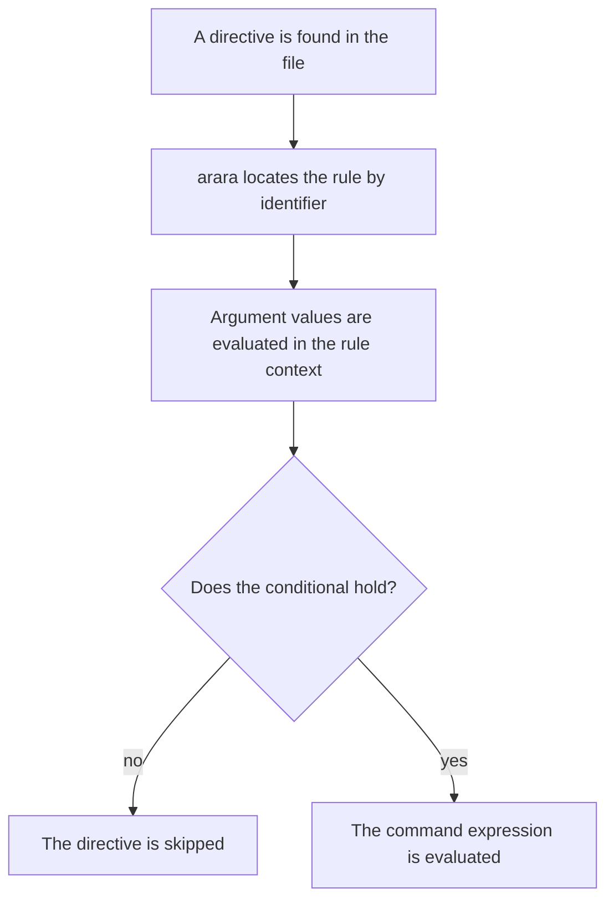
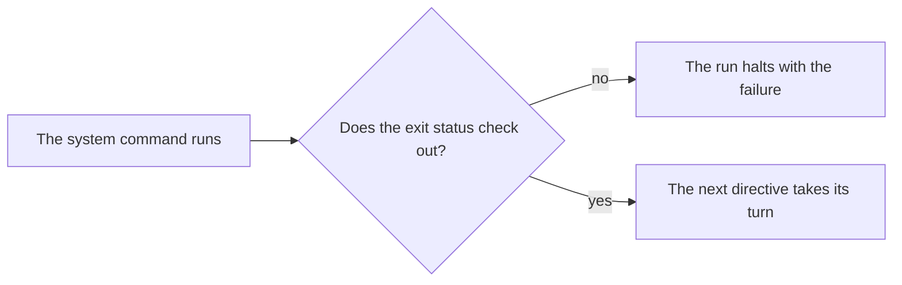

+++
title = "Important concepts"
description = "Rules, directives, file types, the header, sessions — the vocabulary the whole manual speaks"
weight = 2
+++

Time for our first proper contact with arara! I must stress that it is very
important to understand a few concepts on which arara relies before we proceed
to the usage itself. Do not worry, these concepts are easy to follow, yet they
are vital to the comprehension of the application and the logic behind it.

# Rules

A *rule* is a formal description of how arara handles a certain task. For
instance, if we want to use `pdflatex` with our tool, we should have a rule
for that. Directives are mapped to rules, so a call to a nonexistent rule
`foo`, for instance, will indeed raise an error:

```sh
$ arara foo.tex
  __ _ _ __ __ _ _ __ __ _
 / _` | '__/ _` | '__/ _` |
| (_| | | | (_| | | | (_| |
 \__,_|_|  \__,_|_|  \__,_|

arara 8.0.0, the cool TeX automation tool.

Processing "foo.tex" (size: 93 B, last modified: 2026-10-09 09:41:07), please
wait.

ERROR -------------------------------------------------------------------------
I could not find a rule named "foo" in the provided rule paths. Perhaps a
misspelled word? I was looking for a file named "foo.yaml" in the following
paths in order of priority: 
  - /opt/islandoftex/arara/rules

TOTAL FAILURE · 1 file, 0 tasks

Elapsed time: 0.1044 seconds
```

Once a rule is defined, arara automatically provides an access layer to that
rule through directives in the source code, a concept formally introduced later
in this chapter. Observe that a directive reflects a particular instance of a
rule of the same name, i.e., a `foo` directive in a certain source code is an
instance of the `foo` rule.

A rule is a small Lua script that returns a table describing the task, and the
convention is plain: if you have a rule named `pdflatex`, the file must be
named `pdflatex.lua`, placed somewhere arara can find it. The script returns
five keys, two of them optional. Here is the heart of the official `pdflatex`
rule, trimmed for teaching:

```lua
return {
  identifier = "pdflatex",
  name = "PDFLaTeX",
  authors = { "Island of TeX" },
  commands = {
    {
      name = "PDFLaTeX engine",
      command = function(ctx)
        return get_command(ctx.branch, ctx.interaction, ctx.shell,
                           ctx.synctex, ctx.options, ctx.reference.file_name)
      end
    },
  },
  arguments = {
    {
      identifier = "shell",
      flag = function(ctx, value)
        return is_true(value, "--shell-escape", "--no-shell-escape")
      end
    },
  }
}
```

The keys, one by one:

- **`identifier`** — the rule's unique name, matched by directives. Lowercase
  letters without spaces, accents or punctuation, as good practice demands.
  The filename follows the identifier: `pdflatex` lives in `pdflatex.lua`.

- **`name`** — the name of the *task* as arara will display it in the output,
  enclosed in parentheses.

- **`authors`** — a list of strings, so you know whom to write stern electronic
  communications to when a rule misbehaves. Optional, but we do love blaming
  people properly.

- **`commands`** — a list of *subtasks*. Each element holds a `name` (also
  optional, though naming your subtasks is good manners) and a `command`
  function that receives a context table and answers with what the task must
  do: a command to run, a boolean that says whether the computation succeeded,
  or a list mixing both — arara takes care of executing each element in order.

- **`arguments`** — the rule's expected parameters, available to the user
  through directives. Each argument has an `identifier`, and two optional
  companions: a `flag` function, evaluated when the user provides a value, and
  a `default` value for when the user does not. A rule with no arguments
  simply declares an empty list.


The rules included in the core distribution live in a `rules/` directory
beside the tool itself, and their filenames carry an `arara-rule-` prefix in
the TeX tree. You can add your own rule paths, in order of priority, so the
location of the default rules is arara's concern, not yours — but it is
important to acknowledge they exist.



Long-time users will remember rules written in YAML. That format is
deprecated, and version 8 tells you so whenever it is used, but it still works
while the transition lasts. All official rules ship in both dialects, and the
older one is documented in [Migration](Migration.md) for those who must tend
to old rules before retiring them. The Lua format is what this manual teaches.



As a bonus, the acronym *YAML* rhymes with the word *camel*, so arara has been
environmentally friendly for quite a while. Speaking of camels, there is the
programming reference as well, since this amusing animal is usually associated
with Perl and friends.


# The life of a directive

Since rules and directives work in pairs, it helps to see the whole journey a
directive takes, from the comment in your source to the exit status of a
command. The journey folds at the conditional — the first half resolves the
directive:



When the conditional holds, the second half takes over: the command runs,
and answers for its exit status.



Every element of that journey gets its own section in this chapter or the
next; the diagrams are a map you can return to whenever the pieces start
blurring together.

# Directives

A *directive* is a special comment inserted in the source file in which you
indicate how arara should behave. You can insert as many directives as you
want, and the tool will read and extract them from the beginning of the file —
how far it reads is the header's business, a few sections ahead.

There are two types of directives in arara, and they determine the way the
corresponding rules will be instantiated. Note that directives are always
preceded by the `arara:` pattern.

- **Empty directive**: this type of directive has already been mentioned in
  [Introduction](Introduction.md). It has only the rule name, which refers to
  the `identifier` key of the rule of the same name. All rule arguments are
  mapped to empty lists, except the ones with `default` values, which are
  mapped to lists containing single elements.

  ```tex
  % arara: pdflatex
  ```

- **Parametrized directive**: this type of directive also has the rule name,
  and additionally contains a map of parameters providing extra information
  to the corresponding rule. The map is written inline, in the YAML style —
  yes, the map is still YAML by specification, even under the Lua engine; it
  is how directives speak.

  ```tex
  % arara: pdflatex: { shell: yes }
  ```

  Observe that arara relies on named parameters, so they are mapped by their
  corresponding argument identifiers and not by their positions. The syntax
  for a parameter is plain:

  ```
  key : value
  ```

  Virtually any type of data can be used as a parameter value — lists,
  integers, booleans and other maps are all welcome, provided the rule
  handles them properly.

When handling parametrized directives, arara always checks whether directive
parameters and rule arguments match. If we try to inject a nonexistent
parameter in a directive, the tool will raise an error about it:

```sh
$ arara keys.tex
  __ _ _ __ __ _ _ __ __ _
 / _` | '__/ _` | '__/ _` |
| (_| | | | (_| | | | (_| |
 \__,_|_|  \__,_|_|  \__,_|

arara 8.0.0, the cool TeX automation tool.

Processing "keys.tex" (size: 107 B, last modified: 2026-10-09 09:41:12), please
wait.

ERROR -------------------------------------------------------------------------
I found these unknown keys in the directive: (bogus). This should be an easy
fix, just remove them from your map.

TOTAL FAILURE · 1 file, 0 tasks

Elapsed time: 0.1531 seconds
```

As the message suggests, either remove the unknown parameter from the
directive or rewrite the rule in order to accept it as an argument. The first
option is, of course, easier.

## Multiline directives

Sometimes, directives can span several columns of a line, particularly the
ones with several parameters. We can split a directive into multiple lines by
using the `arara: -->` mark (also known as *arrow notation* during
development) on each line that should compose the directive. We call it a
*multiline directive*:

```tex
% arara: pdflatex: {
% arara: --> shell: yes,
% arara: --> synctex: yes
% arara: --> }
```

It is important to observe that the lines do not need to be contiguous, i.e.,
provided that the syntax for parametrized directives holds for the line
composition, lines can be distributed all over the code. In fact, the log file,
when enabled, will contain a list of all line numbers that compose a
directive.


Although it is possible to spread the lines of a multiline directive all over
the code, it is considered good practice to keep them together for easier
reading and editing. In any case, you can always see which lines compose a
directive by inspecting the log file, covered in [Logging](Logging.md).


## Directive conditionals

arara provides logical expressions, evaluated at runtime, in order to
determine whether and how a directive should be processed. The feature is
named *directive conditional*, or simply *conditional*. The following list
describes all conditional operators available in the directive context.

- **`if`** — evaluated beforehand: the directive is interpreted if, and only
  if, the result is true. When the conditional holds, the directive is
  executed at most once.

  ```tex
  % arara: pdflatex if missing('pdf') || changed('tex')
  ```

- **`until`** — the directive is interpreted the first time, then the
  expression is evaluated. While the result holds false, the directive is
  interpreted again and again. There are no guarantees of proper halting.

  ```tex
  % arara: pdflatex until !found('log', 'undefined references')
  ```

- **`unless`** — technically an inverted `if`: the expression is evaluated
  beforehand, and the directive is interpreted if, and only if, the result is
  false.

  ```tex
  % arara: pdflatex unless unchanged('tex') && exists('pdf')
  ```

- **`while`** — the expression is evaluated beforehand, the directive is
  interpreted if the result is true, and the process is repeated while the
  result still holds true. There are no guarantees of proper halting.

  ```tex
  % arara: pdflatex while missing('pdf') ||
  % arara: --> found('log', 'undefined references')
  ```

Several helper methods are available in the directive context to ease the
writing of conditionals, such as `missing`, `changed`, `found`, `unchanged`
and `exists`, featured in the previous examples. They are properly detailed
later on, in [Rules](Rules.md).


Although there are no conceptual guarantees for the proper halting of
unbounded loops, we have provided a technical solution for potentially
infinite iterations: arara enforces a predefined maximum number of loops. The
default value is 10, and it can be overridden either in the configuration
file or with a command line flag, both covered in
[The command line](CommandLine.md).


## The two dialects of conditionals

The conditionals above speak MVEL, the dialect of the default engine — a
first run of the tool evaluates them exactly as written. When you switch to
`--engine lua`, the same four operators and the same helpers are available,
but the compound expressions spell their logical operators the Lua way:

| Meaning | MVEL, the default engine | Lua, `--engine lua` |
|---|---|---|
| conjunction | `&&` | `and` |
| disjunction | `\|\|` | `or` |
| negation | `!` | `not` |

The same conditional, one in each dialect:

```tex
% arara: pdflatex while missing('pdf') || changed('tex')
```

```tex
% arara: pdflatex while missing('pdf') or changed('tex')
```

A condition that is a single helper call translates verbatim between the
dialects; a compound one does not — the operators are the engine's own, and
a conditional written for one engine will not parse under the other. The
whole story, dialect by dialect, lives in [Engines](Engines.md).

## Replicating directives over files

The directive context also features a special parameter named `files`, which
expects a non-empty list of file names as plain string values. For each
element of this list, arara will replicate the current directive and point the
element being iterated as the current `reference` value, resolved to the
proper absolute, canonical path of the file name:

```tex
% arara: pdflatex: { files: [ doc1.tex, doc2.tex ] }
Hello world.
\bye
```

It is important to observe that, in this case, the file being processed by
arara might be a plain TeX document, while `pdflatex` is actually being called
on two LaTeX documents — first `doc1.tex`, and then, at last, `doc2.tex`.
Even when a directive is interpreted with a file other than the one being
processed, helper methods in the rule context still give access to the
original file and reference, detailed in [Rules](Rules.md).

# The header

By default, arara reads directives from the *header* of your file — the
initial block of lines that look like they belong together. The boundary is
simple and honest: starting from the top, the tool reads a line when it is
blank or when it matches the pattern of the file's type, and stops at the
first line that is neither. For a TeX document, where the pattern matches
comment lines, this means the header is the run of comments and blank lines
that opens the file — the natural home of directives.

```tex
% arara: pdflatex
% arara: bibtex
\documentclass{article}
...
```

In the example above, the header ends at `\documentclass{article}` — the
first line that is neither blank nor a comment — so the two directives are
found, and anything below stays unexplored. If a directive hides in the body
of the document, arara will not see it, and the tool will tell you so with the
no-directives error you have already met.


If you want arara to look beyond the header, the `-w`/`--whole-file` flag
tells the tool to read the entire file instead. The choice can also be made
in the configuration file, covered in [Configuration](Configuration.md).


# File types

Every file arara processes has a *type*, and the type is a plain pair: an
*extension* and a *pattern*. The extension decides which files the type
claims; the pattern decides which lines inside those files can hold
directives. The tool knows a handful of types out of the box — `tex` and
friends, each with its own comment pattern — and you can declare your own
types in the configuration file, extension and pattern together:

```yaml
filetypes:
  - extension: my
    pattern: '^\s*--\s*'
```

The same declaration in the Lua configuration format:

```lua
return {
  file_types = {
    { extension = "my", pattern = "^\\s*--\\s*" }
  }
}
```


Observe the doubled backslashes in the Lua string. In YAML, a single-quoted
pattern is literal — `'^\s*--\s*'` works as written. In Lua, string escapes
are processed, so every backslash in the pattern doubles up. Getting this
wrong is the classic first scratch of every new configuration.


When arara looks for the type of a file, it walks the list of known types and
answers with the first one whose extension matches. The order of the walk is
a single tier: the types your configuration declares come first, in the order
you declared them, and the built-in defaults follow, in their own order.


Older manuals described a two-tier priority between configured and default
types. The truth the code keeps is simpler: one list, your types first in
declaration order, the defaults after. A file type you declare wins over a
default of the same extension simply by standing ahead of it — there is no
second rule to remember.


# Sessions

A *session* is the shared memory of one arara run: a simple key-and-value map
that rules can read and write while they work. Two families of keys live
there from the start:

- **`environment:`** — when arara starts, it copies the environment variables
  of the process into the session, each under its `environment:`-prefixed
  name. A rule can ask whether the session holds `environment:PATH` and act
  accordingly.

- **`arg:`** — every call parameter you provide on the command line with
  `-P`/`--call-property` lands in the session under its `arg:`-prefixed name,
  ready for any rule to read. It is the simplest channel between you and the
  rules of a run.

Rules reach the session through `getSession()` and its table of operations —
`get`, `put`, `contains`, `remove` and `clear` — and the log file, when
enabled, now records every mutation as it happens, so you can watch the
session's story unfold in [Logging](Logging.md).

# The working directory

arara resolves every file it processes against a *working directory* — the
directory the tool takes as its ground. By default, it is the directory you
invoke arara from; the `-d`/`--working-directory` flag moves it, and a
project specification can give each project a directory of its own, as we will
see in [Projects](Projects.md). The working directory also decides where the
log file and the file database live when they carry relative names — a
subtlety worth returning to in [Logging](Logging.md) and
[The file database](Database.md).

# Exit statuses

For each subtask, arara checks the corresponding *exit status* available
after the command execution. In general, a successful execution yields 0 as
its exit status, and the run proceeds to the next directive in the queue;
anything else halts the run, and the failure is reported — both on the
console and as arara's own exit status, so scripts calling arara can react.

A rule can override the check: the `exit` key of a subtask holds a function
that receives the actual code and answers whether it counts as success. If a
command signals success with a nonzero value, the rule can say so:

```lua
exit = function(code)
  return code > 0
end
```

And if a task should never fail the run regardless of what the command says,
the function can simply return `true` — the `clean` rule has been politely
succeeding this way for years.

For the deprecated YAML rules you will meet in the wild, the same override is
a plain MVEL expression:

```yaml
exit: value > 0
```

The old era's material is gathered in [Migration](Migration.md).

That is the vocabulary: rules describe tasks, directives request them, file
types decide what arara reads, the header decides how far, sessions remember,
and exit statuses decide when to stop. With these words in hand, the rest of
the manual is a long conversation you are now equipped to have.
