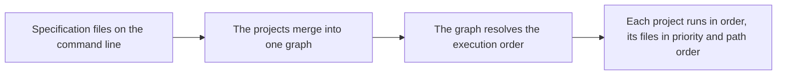

+++
title = "Projects"
description = "The invocation as a set of projects — specifications, merging, ordering, and the anonymous project"
weight = 7
+++

So far, every arara invocation in this manual has been a conversation with
loose files: directives in headers, rules found on paths, one file after
another. That conversation carries a whole project poorly — a thesis
sprawled over directories, a book whose chapters build in dependency
order, a workflow where some files need their own settings. Version 7
planted the seed with project specifications; version 8 grew it into the
model this chapter teaches: *an arara invocation is a set of projects*,
and the command line is where you name them.

# The specification file

A *project specification* is a Lua script carrying the `.proj.lua`
extension — the extension is the whole identity: a file named
`book.proj.lua` is always a specification, parsed or rejected, and never
quietly treated as a plain document. A plain `.lua` file, on the other
hand, is an ordinary input like any other, processed through its configured
file type. The suffix draws the line, and no failure crosses it — a broken
specification is a hard error, not a fallback.

The script returns a table with four keys, three of them optional:

```lua
return {
  name = "The Book Project",
  working_directory = "book",
  files = {
    ["main.tex"] = { },
    ["chapters/chapter1.tex"] = { },
    ["chapters/chapter2.tex"] = {
      priority = 10,
      directives = { "% arara: pdflatex: { draft: yes }" }
    }
  },
  dependencies = { "figures", "extras" }
}
```

The keys, one by one:

- **`name`** — the project's name, displayed on the console when a run
  carries more than one project, and the name other specifications use in
  their dependencies. When the key is absent, the project is *nameless*
  and arara derives the name from the specification file's base name:
  `book.proj.lua` names its project `book`. The derived name has to be a
  name — a specification file named so its derivation comes out blank or
  whitespace is rejected, though a specification whose projects all
  declare their own names runs fine however the file itself is named. Two
  projects cannot share a name in one run, and two names are reserved
  against collision: the model name the anonymous project carries, and the
  anonymous project's localized label — so a Brazilian user cannot name a
  project `Arquivos avulsos` any more than an English user can name one
  `Single files`.

- **`working_directory`** — the directory the project calls home. File
  names inside the project resolve against it, the file database anchors
  there, and the configuration file is looked up in it. A relative value
  resolves against the directory of the run; an absolute value is itself.

- **`files`** — the project's files, the one mandatory key: a project
  without files is not a project, and the parser rejects it. Each key is a
  file path resolved against the working directory; each value is a table
  with four optional members:

  - `file_type`: the file's type. When absent, arara detects the type by
    extension — the single-tier lookup taught in
    [Important concepts](Concepts.md).
  - `priority`: an integer deciding the file's order *within* the project.
    The default is zero; higher priorities run first; ties resolve by
    path, so the order is always deterministic.
  - `directives`: a list of directive strings carried by the file —
    prepended to whatever the file's own header holds, so a specification
    can drive a file that carries no directives of its own.
  - `dependencies`: a list of file names inside the same project that this
    file depends on — a chapter depending on its bibliography, a listing
    depending on its generated file.

- **`dependencies`** — the project-level dependencies: a list of *project
  names* this project depends on. A dependency naming no project in the
  run is rejected with the enumeration of the names that exist, so typos
  cannot quietly reorder a build.

# Merging and ordering

Pass several specification files to arara and they become one run. The
specifications merge into a single graph: project-level dependencies
become edges, and the graph decides the order — every dependency before
its dependent, across files, before anything runs:



The resolved order is the run's own narrative: the log records it once,
before any project starts, so the reader knows the sequence before the
details follow. When the graph cannot be resolved — the specifications
form a cycle — the run refuses to start, and the verdict names *only the
projects that lie on a cycle*: a project that merely depends on a cyclic
one is not accused of belonging to it.

Loose files on the command line — the plain documents, the ones without a
specification — ride the same run as one more project: the *anonymous
project*, named after the localized label for single files, its files in
command-line order, its working directory the directory of the run. A
specification and a loose file are both valid arguments to the same
invocation, and the model keeps them apart: the loose file belongs to
exactly one project, and no specification can claim it.

# Priorities within a project

Inside one project, the files run in a deterministic order: *priority
descending, then path*. Higher priorities first; among equals, the paths
sort. The rule is small and total — no declaration order, no tie left to
chance — so the same specification always runs the same way:

```lua
files = {
  ["low.tex"] = { },
  ["high.tex"] = { priority = 10 },
  ["middle.tex"] = { priority = 5 }
}
```

The project above runs `high.tex`, then `middle.tex`, then `low.tex` —
and a fourth file of priority ten would sort beside `high.tex` by path.

# Projects and their configurations

Every project carries its working directory, and the configuration lookup
follows: the project's directory is searched for a configuration file —
the same names, the same two formats, the same order taught in
[Configuration](Configuration.md) — so a project's files find their rules
and file types through the configuration that lives beside them, not
through whatever the invocation directory happens to carry. The file
database anchors at the project's working directory too, so projects
sharing a run keep their `changed()` memories apart.


Loose files resolve through the configuration of the invocation directory,
as always — the per-project lookup belongs to the projects. And the
command line remains the command line: a file claimed by both a
specification and the command line itself is rejected, because a file
belongs to exactly one project in a run.


That is the model: specifications name projects, projects carry files and
their own working directories, the graph orders the run, the loose files
ride along as the anonymous project, and every verdict — the order, the
cycle members, the collisions — is told in the run's own words. For the
old model's differences, and for the specification syntax of version 7
you might meet in older projects, [Migration](Migration.md) holds the
correspondence.
